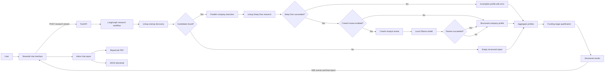

# Startup Chatbot

### Multi-Agent AI Investment Research Assistant

Startup Chatbot, internally known as **ArabiAgent**, is a local-first research application that helps investors discover and investigate startups from natural-language investment criteria. It combines structured web research, graph-based orchestration, optional local-LLM analyst reviews, and a conversational reporting interface.

Traditional startup sourcing requires repeated searches across company websites, funding announcements, and other public sources. Analysts must then normalize incomplete information, compare companies, and assess each candidate against an investment thesis. Startup Chatbot automates parts of that workflow while retaining sources, missing-data indicators, and research errors in the final report.

The application is a research assistant—not an autonomous investment decision-maker. Its findings and AI-generated analysis require independent verification.

## Key Features

1. **Natural-language thesis input** — Describe target sectors, geographies, funding stages, financial thresholds, and other criteria in plain language.
2. **Unified research attributes** — Select built-in attributes or add up to 20 custom fields in the same tag-based input.
3. **Linkup startup discovery** — Discover identifiable companies and supporting source URLs through structured Linkup searches.
4. **Concurrent Deep Dive research** — Research multiple companies in parallel, with a configurable concurrency limit.
5. **LangGraph orchestration** — Route discovery results into parallel company-analysis branches and aggregate their outputs.
6. **Optional CrewAI analyst reviews** — Use a local Ollama model to summarize evidence, flag gaps or risks, and propose follow-up questions.
7. **Funding-stage matching** — Compare sourced funding-stage evidence with stages explicitly requested in the thesis.
8. **Source-backed attributes** — Retain a supporting URL for each verified research fact and mark unavailable facts explicitly.
9. **SSE progress streaming** — Stream real discovery, research, review, completion, and failure events from FastAPI.
10. **Conversational Streamlit UI** — Present each thesis, live activity, and final response as a research conversation.
11. **Session conversation history** — Keep multiple reports available during the current Streamlit session.
12. **Complete in-chat reports** — Display executive metrics, startup comparisons, company profiles, sources, analyst reviews, and research issues directly in the app.
13. **PDF and JSON exports** — Download the report associated with each completed conversation.
14. **Failure isolation** — Preserve successful company profiles when another parallel Deep Dive fails or an optional CrewAI review is unavailable.

## How the AI System Works

| Component | Responsibility |
| --- | --- |
| **Linkup** | Performs external startup discovery and structured fact research. Discovery returns candidate companies; each Deep Dive requests the user-selected attributes and evidence URLs. |
| **LangGraph** | Owns workflow state and control flow. It runs discovery, fans companies out into parallel research nodes with `Send`, and aggregates company profiles. |
| **CrewAI** | Defines specialized, structured LLM tasks. It optionally reviews each company's sourced evidence and powers a separate thesis-enhancement endpoint. |
| **Ollama** | Runs the configured language model locally through its OpenAI-compatible endpoint. No paid hosted LLM is required for CrewAI tasks. |
| **FastAPI** | Validates API requests, invokes workflows, qualifies funding stages, and exposes both standard JSON and SSE streaming research endpoints. |
| **Streamlit** | Provides the thesis composer, unified attribute selector, conversation history, live activity, inline report, and download controls. |
| **Pydantic** | Validates request payloads, startups, research facts, analyst reviews, qualification status, and final responses. |
| **ReportLab** | Generates the downloadable PDF from the same structured report displayed and exported as JSON. |

### LangGraph versus CrewAI

LangGraph is the orchestration layer: it controls state, branching, parallel company execution, and result aggregation. CrewAI does not orchestrate the overall research graph. Instead, it runs bounded local-LLM tasks for optional analyst reviews and for the separate thesis-enhancement API.

The current Streamlit workflow sends the user's **original thesis directly** to startup discovery, research, and funding-stage qualification. The backend still exposes `POST /api/enhance-query`, which invokes a CrewAI/Ollama enhancement graph and is available for API clients, but the frontend does not call it automatically.

## Architecture



CrewAI review failures are logged and do not invalidate otherwise successful Linkup research. Deep Dive failures become incomplete profiles containing the requested attribute names and an explicit error. Funding-stage qualification evaluates reported stage evidence; it is not a complete thesis-eligibility decision.

## Application Workflow

1. Enter an investment thesis.
2. Select predefined research attributes or type custom attributes.
3. Configure the maximum number of startups.
4. Select **Run Research** once.
5. Follow real backend progress events in the assistant response.
6. Compare startups in the complete in-chat report.
7. Expand company profiles to inspect evidence, missing information, qualification explanations, and optional analyst findings.
8. Download the same report as PDF or JSON.

## Installation and Setup

### Prerequisites

- Python **3.12**
- [Ollama](https://ollama.com/) for local CrewAI tasks
- A [Linkup](https://www.linkup.so/) API key

### 1. Clone and create a virtual environment

```bash
git clone https://github.com/sanadf/startup_chatbot.git
cd startup_chatbot
python3.12 -m venv .venv
source .venv/bin/activate
```

On Windows PowerShell, activate the environment with:

```powershell
.venv\Scripts\Activate.ps1
```

### 2. Install dependencies

```bash
python -m pip install --upgrade pip
python -m pip install -r requirements.txt
```

### 3. Configure environment variables

```bash
cp .env.example .env
```

Edit `.env` locally:

```dotenv
LINKUP_API_KEY=your_linkup_api_key_here
LOCAL_LLM_MODEL=llama3.2:3b
OLLAMA_BASE_URL=http://127.0.0.1:11434/v1
BACKEND_URL=http://127.0.0.1:8000
ENABLE_CREWAI_REVIEW=true
MAX_CONCURRENT_AGENTS=3
```

| Variable | Purpose |
| --- | --- |
| `LINKUP_API_KEY` | Required credential for startup discovery and Deep Dive searches. |
| `LOCAL_LLM_MODEL` | Ollama model used by CrewAI; defaults to `llama3.2:3b`. |
| `OLLAMA_BASE_URL` | OpenAI-compatible Ollama endpoint; defaults to `http://127.0.0.1:11434/v1`. |
| `BACKEND_URL` | FastAPI base URL used by Streamlit; defaults to `http://127.0.0.1:8000`. |
| `ENABLE_CREWAI_REVIEW` | Set to `true` to run optional company analyst reviews; defaults to `false` when absent. |
| `MAX_CONCURRENT_AGENTS` | Maximum simultaneous Linkup Deep Dive requests; defaults to `3`. |

Never commit `.env`. The included `.env.example` contains placeholders only.

### 4. Install and start Ollama

Install Ollama using its platform instructions, then pull the model configured above:

```bash
ollama pull llama3.2:3b
ollama serve
```

If Ollama is already running as a system service, a separate `ollama serve` process is unnecessary. Linkup research can still run when optional CrewAI reviews are disabled.

### 5. Start the application

In one activated terminal:

```bash
uvicorn backend.main:app --reload
```

In another activated terminal:

```bash
streamlit run frontend/app.py
```

Open [http://localhost:8501](http://localhost:8501). FastAPI runs at [http://127.0.0.1:8000](http://127.0.0.1:8000) by default.

## Example Usage

**Illustrative thesis**

> Find early-stage artificial intelligence startups in Saudi Arabia and the UAE operating in fintech or healthcare technology, focusing on Seed and Series A companies with identifiable founders and publicly available funding information.

**Illustrative research attributes**

- Company Name
- Website
- Founders
- Year Founded
- Funding Stage
- Total Funding
- Headquarters
- Saudi market presence

The resulting report contains an executive overview, a startup comparison table, expandable company profiles, every requested attribute, source links, funding-stage qualification and explanation, optional CrewAI summaries, evidence gaps, due-diligence questions, and explicit research failures or missing values. These are examples of report fields, not claims about specific companies.

## Project Structure

```text
startup_chatbot/
├── backend/
│   ├── agents/
│   │   ├── research_agent.py       # Optional CrewAI company review
│   │   └── thesis_agent.py         # Separate CrewAI thesis enhancement
│   ├── graph/
│   │   ├── enhancement.py          # Enhancement-only LangGraph
│   │   └── workflow.py             # Discovery and parallel research graph
│   ├── models/
│   │   └── schemas.py              # Pydantic API and report models
│   ├── services/
│   │   ├── linkup_service.py       # Discovery and Deep Dive searches
│   │   └── qualification_service.py # Funding-stage comparison
│   └── main.py                     # FastAPI routes and SSE stream
├── frontend/
│   ├── app.py                      # Conversational Streamlit application
│   ├── chat_state.py               # Session conversation state helpers
│   ├── pdf_report.py               # ReportLab PDF generation
│   └── sse_client.py               # FastAPI SSE client
├── tests/
│   ├── test_chat_state.py
│   ├── test_frontend_inputs.py
│   ├── test_pdf_report.py
│   ├── test_qualification_service.py
│   └── test_research_workflow.py
├── .env.example
├── pytest.ini
├── requirements.txt
└── README.md
```

## Automated Testing

The automated suite uses mocked discovery and research functions; it does not need to consume Linkup credits.

```bash
python -m compileall -q backend frontend
python -m pytest tests/ -v
```

The current release passes **27 automated tests** covering:

- Preset, custom, mixed, comma-separated, duplicate, and maximum attribute handling
- Conversation/report association and multiple scans
- PDF and JSON consistency across reruns
- Failed and incomplete scan retention
- Parallel research and company-level failure isolation
- Optional CrewAI review success and failure
- Funding-stage qualification
- PDF generation and untrusted-text escaping
- Frontend authored-string checks

## Limitations

- Public information may be incomplete, outdated, inconsistent, or incorrect.
- Funding-stage matches are narrow stage comparisons, not complete investment-thesis eligibility assessments.
- AI-generated summaries, risks, and follow-up questions require human verification.
- Revenue, funding, customer, and other private company information may not be publicly available.
- Live Linkup discovery and Deep Dive searches consume API credits.
- Local Ollama speed and model quality depend on available hardware and the selected model.
- Conversation history is held in Streamlit session state and may reset after a page refresh or server restart.
- This version does not provide email delivery.
- The application runs locally; there is no hosted public demo in this repository.

## Security and Responsible Use

- Keep API keys in the ignored local `.env` file.
- Treat source content as untrusted and independently verify material claims.
- Review generated reports before sharing them.
- Do not use this tool as the sole basis for an investment decision.

## Author

**Sanad Al-Madani**

GitHub: [github.com/sanadf](https://github.com/sanadf)
